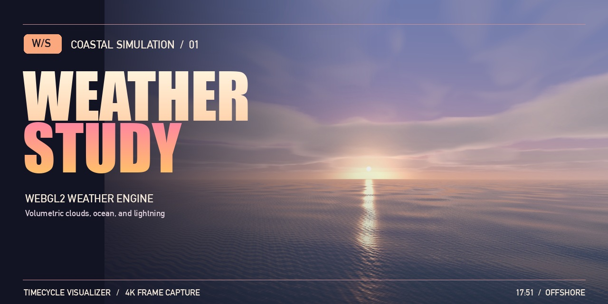
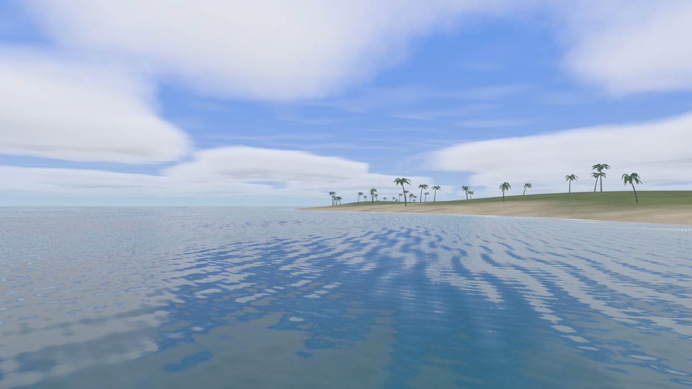
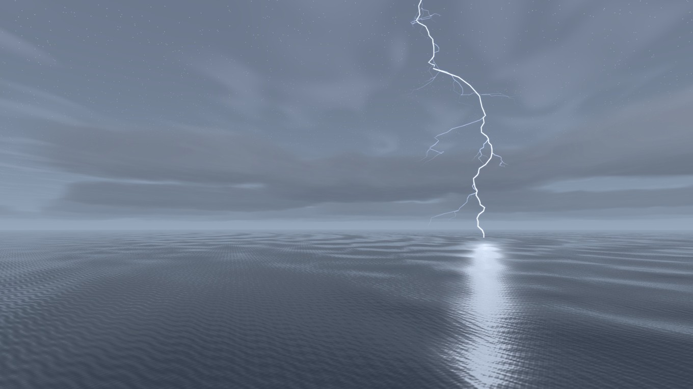

# Weather Study: WebGL2 Weather Engine

An open-source weather engine and timecycle visualizer for the browser. Fly around a procedural coast, change the weather, and see what the same shot looks like at sunset or in a thunderstorm.

The sky uses raymarched volumetric clouds. The sea reflects them, shallow water refracts into the seabed, and a lightning strike lights up both the clouds and the water. The whole demo is generated here: no game files, asset downloads, or API keys.

<p align="center">
  <a href="https://discord.gg/CjcDBg3nf"></a>
  <br />
  <sub>Questions, previews, bug reports and format research. Come say hi.</sub>
</p>

[Screenshots](#screenshots) · [Run locally](#run-locally) · [RPF9 and timecycle research](#rpf9-and-timecycle-research) · [MIT license](LICENSE)

## Screenshots

These are frames from the public demo, not footage from a game.

| Daylight at the waterline | Offshore thunderstorm |
| --- | --- |
|  |  |

## Run locally

```sh
npm ci
npm run dev
```

Open **http://127.0.0.1:5180/** in a WebGL2 browser. Click a weather preset to blend into it, or double-click to switch immediately. Drag to look, use `WASD` and `Q`/`E` to fly, and press `H` to hide the HUD.

The **4K PNG** button renders a clean 3840 × 2160 frame with a higher-resolution cloud pass. Shift-click it to trigger and capture a strike.

## RPF9 and timecycle research

I wanted to see how far a browser renderer could go with the kinds of inputs you find while exploring an RPF9 (`9FPR`) archive. [PercyStar](https://github.com/rpatty-dev/PercyStar) is a separate archive explorer if you're interested in that side of it.

| Research term | What you'll find here |
| --- | --- |
| `.rpf` / RPF9 (`9FPR`) | Archive format context only. This project does not read or unpack archives. |
| `WEATHER.XML` and timecycle XML | A typed `WeatherDataset` with original presets, eased samples over 24 hours, a modifier stack, and `GLOBAL` / `URBAN` regions. The runtime takes this TypeScript structure, not raw XML. |
| `TTPF` (`RDS5` / `ETPF`) and cloud texture dictionaries | Renderer inputs for image layers such as `CloudMapA` and `CloudMapB`. No texture decoder is included. |
| `OceanWaveAmplitude`, `OceanSimPresets` | A wind-driven ocean shader with named wave bands, foam, and caustics. The demo values and wave model are original. |
| `CNavMesh` and coastal meshes | Map-research context only. The demo coastline comes from a generated height field, not from a navmesh. |

Start in [`demo.ts`](src/engine/demo.ts) to edit the presets, terrain, or textures. [`weatherEngine.ts`](src/engine/weatherEngine.ts) handles the timecycle, wind, and weather blending. [`renderer.ts`](src/engine/renderer.ts) draws the atmosphere, ocean, rain, and lightning. The input shapes live in [`types.ts`](src/engine/types.ts) and [`scene.ts`](src/engine/scene.ts).

## Build and audit

```sh
npm run build
npm run verify:release
```

The release check allows the demo's original artwork and screenshots. Keep archives, extracted assets, and private files out of the repo and build.

The audit compares source files byte for byte with the Git index. If an older Windows checkout still contains CRLF line endings, run the audit from a fresh clone.

## Related projects

- [Percy6Stars](https://github.com/Ahmet-Dedeler/Percy6Stars): RPF9/TTPF archive explorer for macOS and Windows
- [awesome-gta6-reverse-engineering](https://github.com/Ahmet-Dedeler/awesome-gta6-reverse-engineering): every open-source GTA VI reverse engineering project in one list
- [bcpack-rs](https://github.com/Ahmet-Dedeler/bcpack-rs): clean-room decoder for Xbox Series BCPack textures
- [rage9-re](https://github.com/Ahmet-Dedeler/rage9-re): `script.rpf` and `anim.rpf` decoder with glTF export
- [bink-player-mac](https://github.com/Ahmet-Dedeler/bink-player-mac): Bink 2 (`.bk2`) video player for macOS

Questions, previews and format research: [join the Discord](https://discord.gg/CjcDBg3nf).
